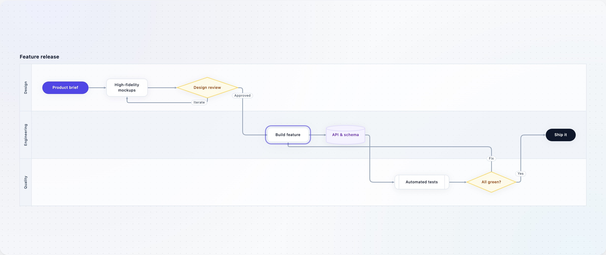
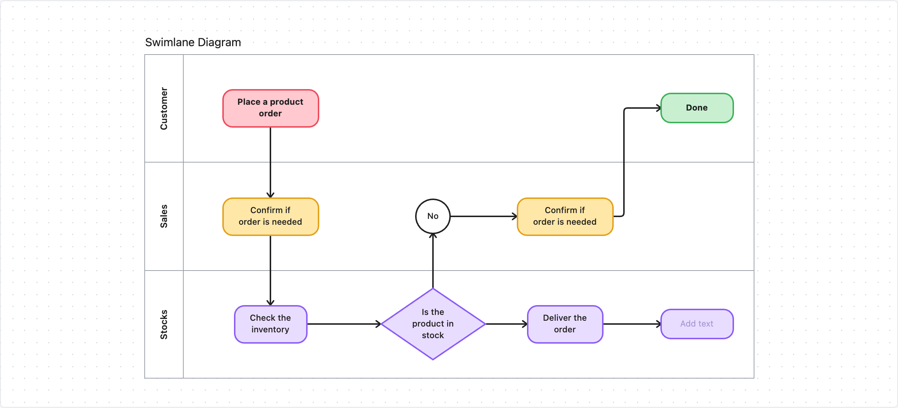
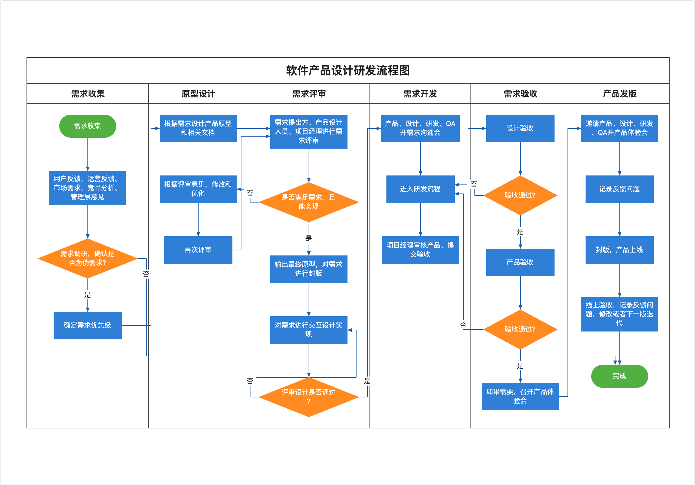
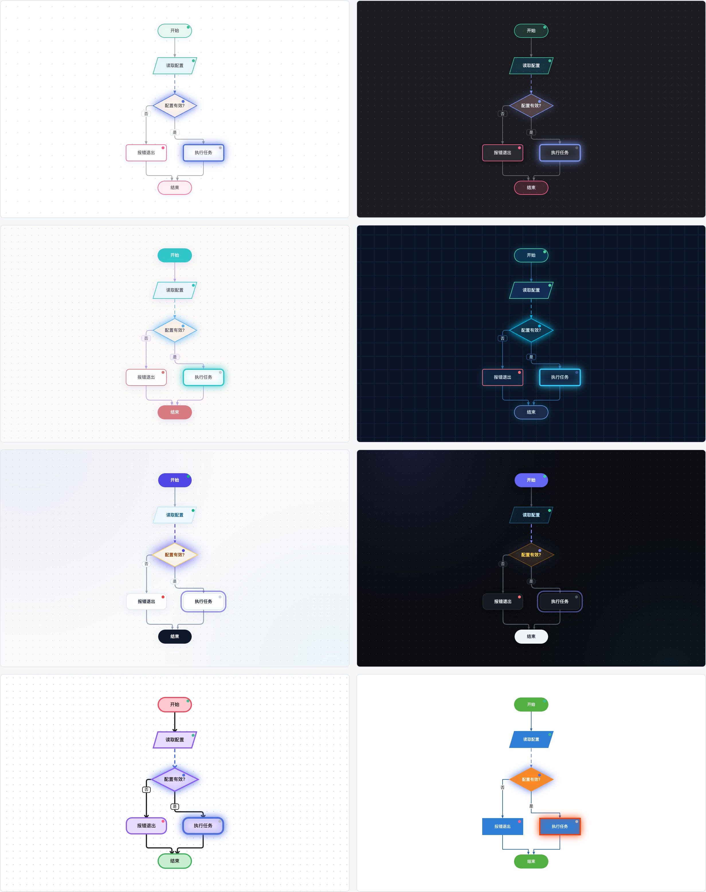
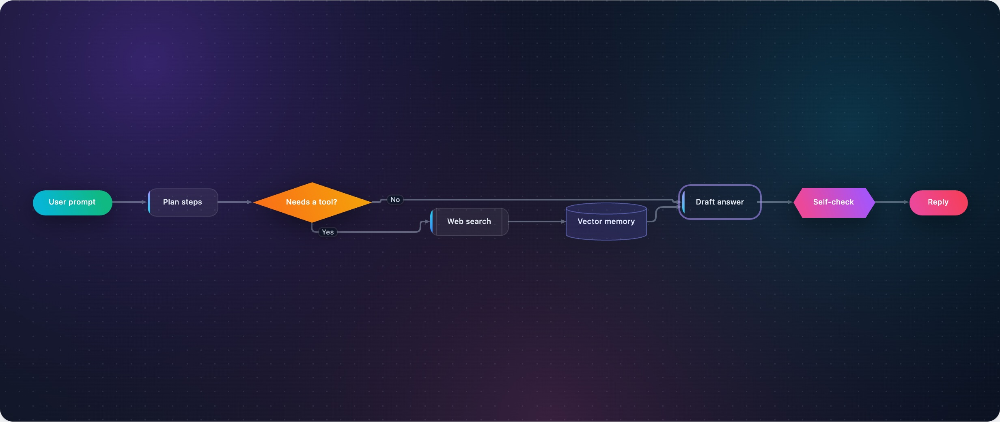

# echarts-flow

[English](./README.md) | 简体中文

基于 [Apache ECharts 6](https://echarts.apache.org/) 可注册自定义系列（`registerCustomSeries`）的流程图与泳道图扩展，支持只读展示和完整编辑。

**在线 demo：** <https://diysimon.github.io/echarts-flow/> · [全部 16 个用例页](https://diysimon.github.io/echarts-flow/test/cases/index.html)



| 白板风格泳道 | 经典分栏泳道 |
| --- | --- |
|  |  |

- 11 种节点形状：开始、结束、处理、判断、输入/输出、圆形、六边形、文档、数据库、子流程、纯文本
- 泳道：横向（行）或竖向（列）、标题、按泳道配色、拖动节点换泳道
- 自动布局（dagre），可选紧凑泳道
- 避障正交路由：绕开节点、平行线错开、端口分散；也支持直线和曲线
- 8 套内置主题，可用 `createFlowTheme` 深度覆盖，支持渐变色；节点、连线、泳道可单独设置样式
- 编辑器：拖动、连线、双击改文字、框选、复制粘贴、方向键微调、对齐参考线、拖连线端点改接、删除、撤销重做、平移缩放；每项能力都可配置
- 整图导出 PNG / SVG；与 Mermaid flowchart、draw.io 文件互相导入导出
- 运行状态展示：pending / running / done / error，运行中的连线有流动动画
- Canvas 与 SVG 渲染都可用，文字按整像素绘制，缩放后依然清晰
- 大图流畅：平移缩放时直接移动已画好的图形，不重建；视口外的元素不绘制

## 安装

```bash
npm install echarts echarts-flow
```

`echarts` 是 peer 依赖，需要 6.0 及以上。

## 快速开始

### 只读展示

```ts
import { init, use } from 'echarts/core';
import { CustomChart } from 'echarts/charts';
import { CanvasRenderer } from 'echarts/renderers';
import { buildFlowOption, calcFitViewport, flowExtension, type FlowGraph } from 'echarts-flow';

use([CustomChart, CanvasRenderer, flowExtension]);

const graph: FlowGraph = {
  nodes: [
    { id: 'start', label: '提交申请', shape: 'start' },
    { id: 'check', label: '金额大于 5000?', shape: 'decision' },
    { id: 'approve', label: '经理审批', shape: 'process' },
    { id: 'end', label: '结束', shape: 'end' },
  ],
  edges: [
    { id: 'e1', source: 'start', target: 'check' },
    { id: 'e2', source: 'check', target: 'approve', label: '是' },
    { id: 'e3', source: 'check', target: 'end', label: '否' },
    { id: 'e4', source: 'approve', target: 'end' },
  ],
};

const chart = init(document.getElementById('chart')!);
const viewport = calcFitViewport(graph, chart.getWidth(), chart.getHeight());
chart.setOption(buildFlowOption(graph, { viewport, theme: 'light' }));
```

节点没有坐标时会自动布局。

ECharts 只在 init 时读取一次 `devicePixelRatio`，浏览器缩放或把窗口拖到另一块屏幕后，画布会被拉伸，文字发虚。`FlowEditor` 会自动处理；只读图表请调用 `watchDevicePixelRatio(chart)`（返回一个停止监听的函数）。

### 编辑器

```ts
import { FlowEditor } from 'echarts-flow';

const editor = new FlowEditor(chart, {
  graph,
  direction: 'TB',
  theme: 'light',
  onChange: (graph) => save(graph),
});

editor.addNode({ shape: 'process', label: '新步骤' });
editor.connect('start', 'approve', '是');
editor.autoLayout();
editor.undo();
```

鼠标和键盘操作（画布获得焦点时）：

| 操作 | 方式 |
| --- | --- |
| 选择、多选 | 单击；Shift / Cmd / Ctrl 点击 |
| 框选 | 按住 Shift 拖空白处（设置 `blankDragAction: 'boxSelect'` 后直接拖） |
| 全选、复制、剪切、粘贴、复制一份 | Cmd/Ctrl + A、C、X、V、D |
| 微调位置 | 方向键移动一个网格，Shift + 方向键移动 10 个 |
| 连线 | 悬停节点后从出现的圆点拖出 |
| 改接连线 | 选中连线后，把两端的圆点拖到别的节点上 |
| 改文字 | 双击节点、连线、泳道表头或标题 |
| 删除、撤销、重做 | Delete / Backspace，Cmd/Ctrl + Z，Cmd/Ctrl + Shift + Z |

拖动节点时，它的边缘或中心和其他节点对齐处会出现参考线，并吸附过去。
这些操作也有对应的 API：`selectAll()`、`copySelection()`、`cutSelection()`、`paste()`、`duplicateSelection()`、`moveSelection(dx, dy)`、`reconnectEdge(edgeId, 'source' | 'target', nodeId)`。

## 导出与互通

```ts
import { fromDrawio, fromMermaid, toMermaid } from 'echarts-flow';

const png = editor.exportPng({ pixelRatio: 2 });       // 整张图的 data URL，不只是可见区域
const svg = editor.exportSvg({ backgroundColor: 'transparent' });
const mermaid = editor.exportMermaid();                // 泳道变成 subgraph
const drawio = editor.exportDrawio();                  // 保留坐标、尺寸、泳道、颜色和箭头

const { graph, direction } = fromMermaid('flowchart LR\n  a([开始]) --> b{通过?} -->|是| c[发布]');
new FlowEditor(chart, { graph, direction });
```

- 不用编辑器时，调用 `exportFlowPng(graph, options)` / `exportFlowSvg(graph, options)`。SVG 导出走服务端渲染，在 Node 里也能用，需要注册 `SVGRenderer`。
- `fromMermaid` 能读节点形状（包括 Mermaid 11 的 `@{ shape: doc }`）、`-->`、`---`、`-.->`、`==>`、`|...|` 和 `-- ... -->` 两种标签写法、`&` 分组、subgraph（变成泳道）以及 frontmatter 里的标题。样式语句会跳过；节点没有坐标，会自动布局。
- `fromDrawio` 读取未压缩的 draw.io 文件（在 draw.io 里：文件 > 属性 > 取消勾选"压缩"）。泳道（swimlane）变成泳道，池（pool）的名字变成标题。

## 数据结构

```ts
interface FlowGraph {
  nodes: FlowNode[];   // { id, label, shape, x?, y?, width?, height?, status?, laneId?, style?, isLocked? }
  edges: FlowEdge[];   // { id, source, target, label?, style?, isLocked? }
  lanes?: FlowLane[];  // { id, label, size?, style?, nodeStyle? }
  title?: string;
}
```

坐标是节点中心点。`label` 中的 `\n` 会保留为换行，过长的文字自动换行并撑高节点。

## 泳道

```ts
const graph: FlowGraph = {
  title: '订单流程',
  lanes: [
    { id: 'customer', label: '客户', nodeStyle: { fill: '#ffc9cf', stroke: '#ef4b5d' } },
    { id: 'sales', label: '销售' },
  ],
  nodes: [
    { id: 'order', label: '下单', shape: 'start', laneId: 'customer' },
    { id: 'confirm', label: '确认订单', shape: 'process', laneId: 'sales' },
  ],
  edges: [{ id: 'e1', source: 'order', target: 'confirm' }],
};

new FlowEditor(chart, { graph, direction: 'LR', theme: 'whiteboard', layout: { isLaneCompact: false } });
```

- `direction: 'TB'`：泳道是竖排的列，表头在顶部；`'LR'`：泳道是横排的行，表头在左侧。
- `layout.isLaneCompact`：每条泳道从顶部开始排，适合手绘风格的分栏流程图。
- 编辑器 API：`addLane`、`updateLane`（改尺寸会平移后面泳道的节点）、`removeLane`、`setTitle`。

## 主题与样式

内置主题：`light`、`dark`、`macarons`、`tech-blue`、`whiteboard`、`classic`，以及现代风格的 `aurora` 和 `aurora-dark`（克制的产品界面风格：近白或近黑画布、细边框加柔和阴影的卡片、实心靛蓝开始和墨黑结束药丸、判断和数据节点用浅色底区分、环形选中框、悬停时卡片浮起）。效果见 `test/cases/15-aurora.html`。





所有 `fill`、`stroke`、`accent`、泳道填充和主题 `background` 除了颜色字符串，也可以传渐变：

```ts
import { linearGradient } from 'echarts-flow';

const node = { id: 'a', label: '部署', style: { fill: linearGradient(135, '#6366f1', '#a855f7'), textColor: '#fff' } };
// 径向渐变：{ type: 'radial', stops: [{ offset: 0, color: '#fff' }, { offset: 1, color: '#eef2ff' }] }
```

现代风格相关的主题配置：`backdrop.blobs`（固定在屏幕上的径向光晕）、`node.accentWidth`、`node.selectionStyle`（`'stroke'` 或 `'ring'`）、`node.hoverLift`（悬停时阴影放大倍数）、`edge.labelShadowColor`。

```ts
import { createFlowTheme, lightTheme } from 'echarts-flow';

const myTheme = createFlowTheme(lightTheme, {
  edge: { routing: 'curved', targetArrow: 'triangle-open', stroke: '#7b61ff', lineWidth: 2 },
  node: { radius: 12 },
  grid: { type: 'dot' },
});
editor.setTheme(myTheme);
```

样式优先级：主题 < 泳道 `nodeStyle` < 节点/连线自己的 `style`。

- 节点 `style`：`fill`、`stroke`、`lineWidth`、`lineDash`、`textColor`、`fontSize`、`fontWeight`、`radius`、`shadow*`、`opacity`
- 连线 `style`：`stroke`、`lineWidth`、`lineDash`、`routing`（`orthogonal` / `straight` / `curved`）、`cornerRadius`、
  `sourceArrow` / `targetArrow`（`triangle`、`triangle-open`、`vee`、`circle`、`circle-open`、`diamond`、`diamond-open`、`none`）、
  `arrowSize`、`label*`、`opacity`

## 编辑配置

```ts
const editor = new FlowEditor(chart, {
  graph,
  edit: {
    canDelete: false,
    maxZoom: 2,
    validateConnection: (sourceId, targetId) => targetId !== 'start',
    beforeDelete: (selection) => confirm(`删除 ${selection.nodeIds.length} 个节点？`),
  },
});

editor.setEditOptions({ isEnabled: false }); // 运行时修改，只改传入的几项
editor.getEditOptions();
```

| 配置 | 说明 |
| --- | --- |
| `isEnabled` | 总开关，关闭后只读（仍可选择、平移、缩放） |
| `canSelect` / `canMultiSelect` | 选择、多选 |
| `canMoveNodes` / `canConnect` / `canEditLabels` / `canDelete` / `canUndo` / `canChangeLane` | 各项编辑能力 |
| `canBoxSelect` / `blankDragAction` | 框选；拖空白处是平移（`'pan'`，默认）还是框选（`'boxSelect'`），按住 Shift 切换为另一种 |
| `canCopyPaste` / `canReconnect` | 复制粘贴快捷键；拖连线端点改接 |
| `shouldShowAlignGuides` / `alignThreshold` | 对齐参考线及吸附距离（屏幕像素） |
| `canPan` / `canZoom` / `hasKeyboardShortcuts` | 平移、滚轮缩放、键盘快捷键 |
| `shouldSnapToGrid` / `gridSize` | 网格吸附 |
| `minZoom` / `maxZoom` / `wheelZoomSpeed` | 缩放范围和速度 |
| `validateConnection` / `beforeDelete` | 数据规则，对用户操作和 API 都生效，传 `null` 移除 |

开关只限制鼠标和键盘操作，`addNode()`、`connect()` 等 API 调用不受影响。节点或连线设置 `isLocked: true` 后不能被拖动、改名或删除。

## 连线路由

```ts
new FlowEditor(chart, { graph, routing: { isSmart: true, shouldSpreadPorts: true, maxSmartNodes: 150 } });
```

正交连线默认使用避障路由：绕开节点、走泳道边缘的通道、平行线错开、同一条边上的多条线分开接入。
节点数超过 `maxSmartNodes` 时回退为简单路由。

## 大图

- 平移和滚轮缩放时，编辑器直接移动已经画好的图形，指针或滚轮停下后再清晰地重绘一次。1000 个节点时每帧平移从约 38ms 降到约 7ms（Chromium，Canvas 渲染）。
- 滚轮缩放会平滑地过渡到目标比例，不再每格跳一下；触控板双指缩放（ctrl + 滚轮）做了加速。视图移动时忽略悬停，节点从指针下滑过不会触发完整重绘。
- 超过 250 个节点时，平移和缩放帧用 CSS transform 移动已画好的画布，这些帧不做任何绘制。旧画面覆盖不到视图的 80% 时才重绘；缩小时会提前按更小的比例绘制，减少重绘次数。容器没有设置 overflow 时会被设为 `overflow: hidden`。
- 一次完整重绘超过 12ms 时，悬停要等指针停稳 90ms 再重绘，指针扫过大图只重绘一次。
- Canvas 渲染下，背景网格是一个用小图块平铺填充的矩形，不再逐点绘制。
- 只绘制可见区域外扩一个视口范围内的节点和连线。不用编辑器时，给 `buildFlowOption` 传 `viewSize: { width, height }` 也能得到同样的裁剪。
- 文字默认始终绘制。设置 `minLabelPixels`（编辑器选项或 `buildFlowOption` 配置）后，屏幕上小于该像素的文字不绘制。

## 本地开发

```bash
npm install
npm run dev               # 打开 http://localhost:5173/ 是 demo，/test/cases/index.html 是全部用例
npm test                  # 单元测试（Vitest）
npm run test:e2e          # 在 Chromium 里打开每个用例页：无报错、画出图表、截图与基线一致
npm run test:e2e:update   # 重新录制截图基线
npm run check             # 类型检查 + 单元测试 + 构建
npm run build:site        # 生成静态 demo 站点到 site/，main 分支会自动部署到 GitHub Pages
```

截图基线的文件名带平台后缀，因为不同系统的字体渲染不一样。CI 会录制缺失的 Linux 基线并作为 `playwright-snapshots` 产物上传，下载后提交即可开始对比。

发版时修改 `package.json` 的 `version` 和 `CHANGELOG.md`，然后推送 `v0.1.0` 这样的 tag。Release 工作流会跑完检查、带 provenance 发布到 npm（需要仓库 secret `NPM_TOKEN`），并创建 GitHub Release。

`test/cases/` 下有 16 个用例页面，覆盖只读展示、形状与状态、布局方向、编辑、运行监控、JSON 导入导出、大图性能、多实例、主题、泳道、样式配置、编辑配置、aurora 主题展示和导出互通。每个页面都有 Canvas / SVG 切换。

## License

[Apache-2.0](./LICENSE)
